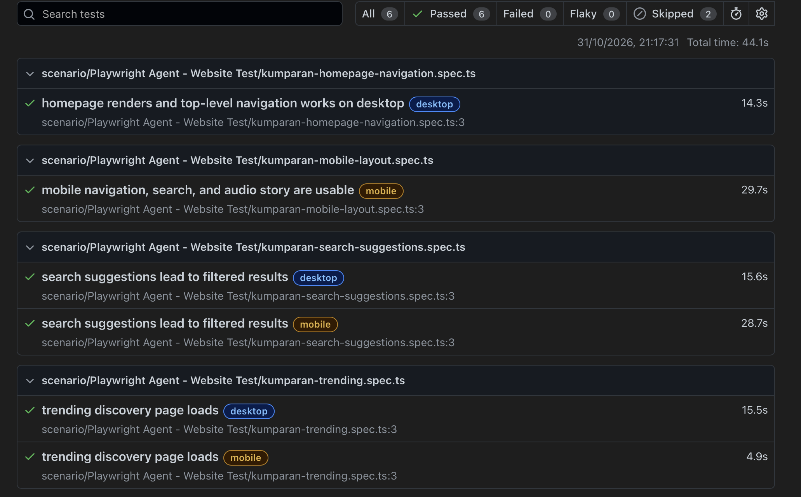

# Kumparan QA Playwright

Playwright tests for the public Kumparan website and the GraphQLZero API. Website projects are configured for desktop Chrome and mobile Pixel 7 emulation.

## Setup

Requirements: Node.js and npm.

From the repository root, install project dependencies and the Chromium browser used by Playwright:

```bash
npm install
npx playwright install chromium
```

## Run Tests

Run all website tests on desktop and mobile:

```bash
npm run test:web
```

Run one project only:

```bash
npm run test:desktop
npm run test:mobile
```

Open the Playwright UI or the HTML report:

```bash
npx playwright test --ui
npm run report
```

Run a specific spec by its path. Quote paths that contain spaces:

```bash
npx playwright test "tests/web/scenario/Playwright - Website Test/kumparan.spec.ts" --project=desktop --project=mobile
```

## Task 1 - Manual Test Cases

The manual QA scenarios, test data, steps, priority, severity, and expected results are in [specs/01-test-cases.md](specs/01-test-cases.md).

## Task 2 - Website Automation

The baseline Playwright website test is [kumparan.spec.ts](tests/web/scenario/Playwright%20-%20Website%20Test/kumparan.spec.ts). Run it on both projects with:

```bash
npx playwright test "tests/web/scenario/Playwright - Website Test/kumparan.spec.ts" --project=desktop --project=mobile
```

## Task 3 - Test Plan and Playwright Agents

The public-site test plan is [specs/kumparan-public-site-test-plan.md](specs/kumparan-public-site-test-plan.md). Generated website specs are in [tests/web/scenario/Playwright Agent - Website Test](tests/web/scenario/Playwright%20Agent%20-%20Website%20Test); the current scenarios cover homepage navigation, Trending, search suggestions, and mobile navigation.

Run those generated scenarios on both projects:

```bash
npx playwright test "tests/web/scenario/Playwright Agent - Website Test" --project=desktop --project=mobile
```

The custom agent definitions are in `.github/agents/`:

- **Planner** (`playwright-test-planner`): explores the public site and saves independent manual scenarios to the test plan.
- **Generator** (`playwright-test-generator`): takes a selected plan scenario, verifies the live UI flow, then writes a Playwright spec in the scenario folder. Review the selectors and assertions before running it.
- **Healer** (`playwright-test-healer`): runs or debugs failing specs, examines the failure and page state, updates the test, then reruns it to verify the fix.

To implement a scenario, open Copilot Chat, select the Planner agent to update or create the plan, then select the Generator agent and provide the plan file, scenario name, and target spec path. After reviewing the generated spec, run that spec with the command above. If it fails, use the Healer agent with the failing spec and error output, then rerun the affected test.

## Task 4 - GraphQLZero API Tests

The GraphQL API tests are in [graphqlzero.spec.ts](tests/web/api/graphqlzero.spec.ts). They use Playwright's `request` fixture and do not use browser page interactions.

Run the API spec once with the desktop project:

```bash
npx playwright test tests/web/api/graphqlzero.spec.ts --project=desktop
```

The file includes five successful queries and three negative cases. Use the `desktop` project for this API-only spec to avoid running the same requests again under the mobile project.


## Actual Result
 
npx playwright show-report

**Task 2**


**Task 3**



**Task 4**


